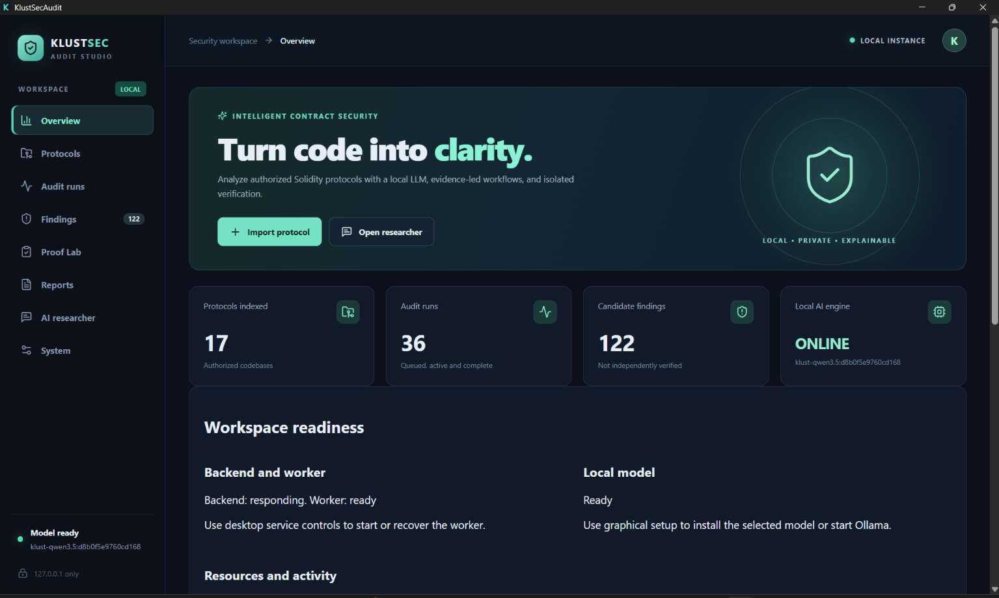
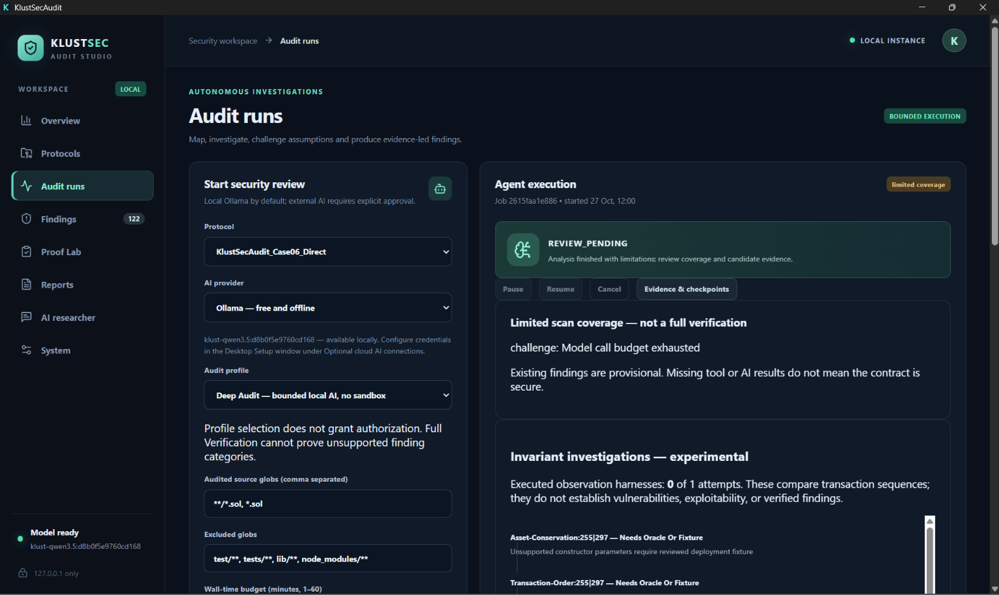
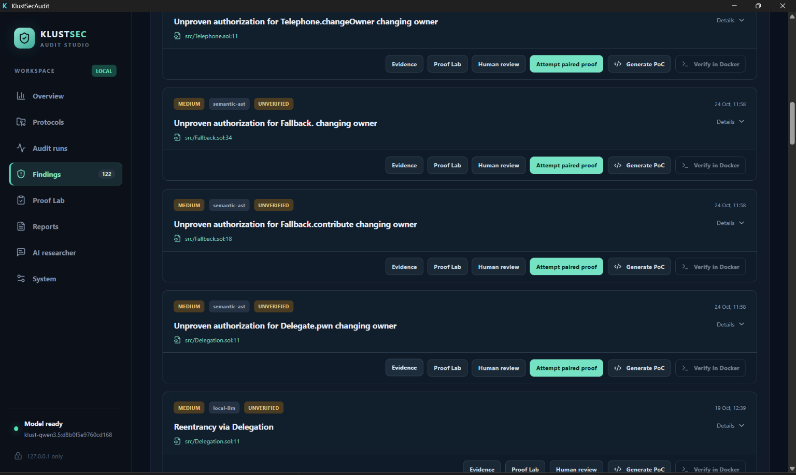
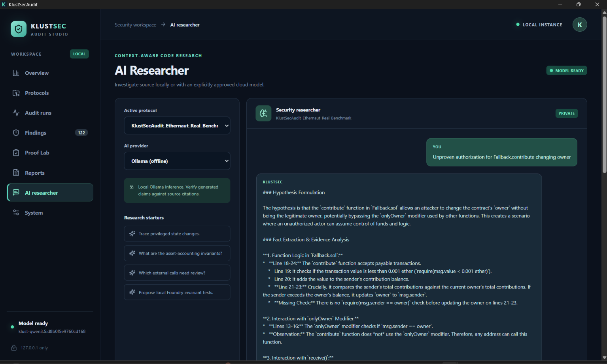

# KlustSecAudit

**A Windows desktop workbench for authorized EVM smart-contract security research.**

[**Download Windows Research Preview v0.3.0**](https://github.com/klustech/klustech-klustsecaudit-releases/releases/download/v0.3.0-preview.1/KlustSecAudit_0.3.0_x64-setup.exe) · [Release notes](https://github.com/klustech/klustech-klustsecaudit-releases/releases/tag/v0.3.0-preview.1) · [SHA-256 checksum](https://github.com/klustech/klustech-klustsecaudit-releases/releases/download/v0.3.0-preview.1/SHA256SUMS.txt) · [Installation guide](INSTALLATION.md) · [Report a problem](https://github.com/klustech/klustech-klustsecaudit-releases/issues/new/choose)

**Status:** Public **pre-release** (`v0.3.0-preview.1`) — unsigned Windows x64 installer. The source code remains private.

> **Research preview, not a certified security auditor.** Independent autonomous exploit-discovery accuracy has **not** been established. Findings are provisional, can be wrong, and require independent reproduction and qualified human review. A scan with no reported findings does not establish security.

## See KlustSecAudit in action

Real screenshots captured from the installed Windows desktop research preview.

### Dashboard and workspace

### Audit workflow and evidence

| Audit runs | Proof Lab |
| --- | --- |
|  |  |
| Configure an authorized Solidity security review and inspect execution stages and provisional results. | Review proof evidence, test status, and verification limitations. |

### AI-assisted investigation

Investigate source code with local Ollama or an optional cloud provider with explicit consent. AI output is **not** independent verification of a vulnerability.

> Screenshots illustrate the interface and available workflows. They do not demonstrate benchmarked autonomous exploit discovery or guarantee that a finding is exploitable.

## What can I do with it?

- **Import and explore** authorized Solidity/EVM projects, including local ZIP archives and supported public sources.
- **Review static signals** using Solidity compilation and Slither when the approved local tooling is available.
- **Investigate with AI** using local Ollama or an *optional*, explicitly approved OpenAI/Anthropic API connection (billed separately by those providers).
- **Run bounded tests** with Foundry in supported, authorized isolated workflows and inspect evidence limitations.
- **Keep records** of research questions, audit runs, provisional findings and evidence; export reports and integrity evidence.

### First-time experience

1. [Download the Windows installer](https://github.com/klustech/klustech-klustsecaudit-releases/releases/download/v0.3.0-preview.1/KlustSecAudit_0.3.0_x64-setup.exe) and [the SHA-256 checksum](https://github.com/klustech/klustech-klustsecaudit-releases/releases/download/v0.3.0-preview.1/SHA256SUMS.txt).
2. Verify the downloaded installer against the published checksum (see [Installation](INSTALLATION.md)).
3. Open the app, complete the guided Windows/WSL setup as applicable, then **Verify environment → Start backend → Open dashboard**.
4. Import **only a project you own or have authorization to audit**.
5. Try source browsing, the AI Researcher, a static review, and report export. Don't interpret a candidate finding as a verified exploit.

**Windows prerequisites:** Windows 10 (build 19045+) or Windows 11 x64, WSL2/virtualization support, at least 8 GB RAM (16 GB recommended), ~20 GB available disk, and internet access during initial setup.

The installer is **not digitally signed**. A refresh reinstallation preserved existing audits on one developer PC, but a fresh installation on a separate clean Windows machine has **not been validated**. Expect setup friction and report it.

## Help us improve it

If you are a Solidity developer, auditor, or security researcher, we'd especially value feedback about:

- Windows setup/WSL compatibility and clear error messages.
- Whether source imports, citations, static analysis and reports are useful.
- False positives or missed cases **on contracts you are authorized to share**.
- Whether the proof/evidence UI distinguishes actual verification from hypotheses clearly.

[**Report an installation bug or request an improvement**](https://github.com/klustech/klustech-klustsecaudit-releases/issues/new/choose). Please include your OS version, release version, steps to reproduce and **redacted** errors. Do not post passwords, API tokens, local credentials, confidential source files, exploit secrets or private audit databases.

## Distribution, security and limitations

- This public GitHub repository hosts **binary releases and documentation** only. It is **not an open-source release** of the application; the application source remains private.
- Public downloads are offered as a research preview; no independent safety certification, comprehensive audit guarantee or commercial service-level support is claimed. Avoid relying on it as the sole security control for deployed financial contracts.
- Local Ollama can be used without paid cloud AI. Cloud AI is optional, requires approval to send scoped source excerpts, and may incur API usage charges.
- Tool setup depends on local Windows/WSL, approved rootless sandbox resources and appropriate permissions. Unknown or incomplete checks are not security passes.
- Do not use KlustSecAudit on systems or code you are not authorized to assess.

See [full installation details](INSTALLATION.md), [release readiness checklist](RELEASE_CHECKLIST.md) and [public release notes](https://github.com/klustech/klustech-klustsecaudit-releases/releases/tag/v0.3.0-preview.1).

**Built by Klustertech.**
